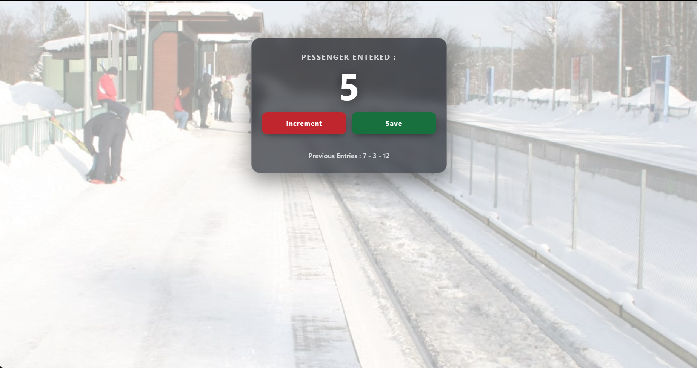

<div align="center">

# 🚇 Subway Passenger Counter

**Tap to count people entering a station, then save the total for each train.**


<!-- Add a screenshot of your page and save it as screenshots/preview.png -->


🔗 **Live demo:** [https://github.com/Aastha-0777/JS/tree/main/passenger-counter](https://github.com/Aastha-0777/JS/tree/main/passenger-counter)

</div>

---

## 📖 About

At a subway gate, an attendant taps a button each time a person walks in. When the train leaves, they press **Save** to record how many boarded, and the counter starts again from zero for the next train.

This small web app replaces the attendant's notebook. It is built with plain HTML, CSS, and JavaScript, with no libraries.

## ✨ Features

- ➕ **Increment** adds one person per click
- 💾 **Save** records the current count and resets it to 0
- 📋 **Previous entries** are listed in order, like `7 - 3 - 12`
- 🚫 **Saving at 0 does nothing**, so there are no empty entries
- 🧠 **Count kept in a JavaScript variable,** not read back from the page
- ⌨️ **Keyboard friendly:** both buttons work with Tab, Enter, and Space
- 📱 **Responsive** glass-card design over a station photo, readable on phones
- 📦 **Zero dependencies:** no frameworks, no build step

## 🚀 Getting Started

```bash
git clone https://github.com/Aastha-0777/JS/tree/main/passenger-counter.git
cd passenger-counter
```

Then open **`index.html`** in your browser. There is nothing to install or build.

> Keep `station.jpg` in the same folder as `style.css`. If it is missing, the page shows a dark background instead.

## 🧪 How to Use

1. Press **INCREMENT** each time someone enters.
2. When the train leaves, press **SAVE**. The number moves into "Previous Entries" and the counter returns to 0.
3. Repeat for the next train.

## ⚙️ How It Works

```
INCREMENT  →  count++  →  show count

SAVE       →  is count 0?  ── yes ──►  do nothing
                  │
                  no
                  ▼
              push count into entries[]
                  ▼
              count = 0  →  show 0
                  ▼
              show entries.join(" - ")
```

<details>
<summary><b>🧠 Code highlight: the Save button</b></summary>

<br>

```js
let count = 0;
const entries = [];

saveBtn.addEventListener("click", () => {
  if (count === 0) return;                    // nothing to save
  entries.push(count);
  count = 0;
  h2.textContent = count;
  spanOutside.textContent = entries.join(' - ');
});
```

**Why the count is a variable:** reading the number back from the page gives a *string*, and `"5" + 1` is `"51"`, not `6`. The variable is the single source of truth, and the page only displays it.

**Why `join` instead of adding `" - "` after every entry:** adding a separator each time leaves one at the end (`7 - 3 - `). Building the text from an array with `join` puts separators only *between* entries.

</details>

<details>
<summary><b>🧩 JavaScript and DOM topics used</b></summary>

<br>

| Topic | Used for |
|---|---|
| `let` and numbers | The changing count |
| Arrays: `push()` and `join()` | Storing and displaying saved entries |
| `getElementById()` | Finding the count and the buttons |
| `document.createElement()` / `appendChild()` | Creating the "Previous Entries" line from JavaScript |
| `textContent` | Updating the page safely |
| `addEventListener("click", ...)` | Reacting to button clicks |
| Early `return` | Ignoring a Save when the count is 0 |

</details>

<details>
<summary><b>✅ Manual test checklist</b></summary>

<br>

| Action | Expected result |
|---|---|
| Open the page | Count is 0 and the line shows "No saved entries yet" |
| Press Save on a fresh page | Nothing changes |
| Increment 7 times, then Save | `Previous Entries : 7` and the count resets to 0 |
| Save 3, then 12 | `Previous Entries : 7 - 3 - 12`, with no extra separator |
| Press Save when the count is 0 | Nothing changes |
| Click Increment 50 times quickly | The count shows exactly 50 |
| Click Increment 10,000 times (from the console) | The count shows 10000 and the layout holds |
| Use only the keyboard (Tab, then Enter or Space) | Both buttons work |

</details>

## 📁 Project Structure

```
<repo-name>/
├── index.html        # Page structure: title, count, and the two buttons
├── script.js         # Counting, saving, and showing the entries
├── style.css         # Layout, colours, and responsive styles
├── station.jpg       # Background photo
├── README.md
└── screenshots/      # Images used in this README
```

## 🗺️ Roadmap

- [x] Increment and save
- [x] Ignore saving at 0
- [x] Entries kept in an array and shown with `join`
- [x] Responsive, keyboard-friendly design
- [ ] Decrement button that never goes below 0
- [ ] Total and highest saved entry (`reduce` and `Math.max`)
- [ ] Undo last save and clear history
- [ ] Press the Space bar to increment
- [ ] Keep entries after a refresh with `localStorage`

## 🧠 What I Learned

- Keeping state in a variable and treating the page as a display of it
- Why `textContent` returns text, and how that causes bugs when doing maths
- Building a clean list from an array with `join`
- Handling edge cases: saving at 0, very fast clicking, large numbers
- Reading my own bugs by testing against a checklist, not just by looking at the screen

## 🖼️ Credits

Background photo: **[passenger-counter\station.jpg]**

---

<div align="center">

Made by **Aastha Lakhatariya** · [@Aastha-0777](https://github.com/Aastha-0777) · MIT License

</div>