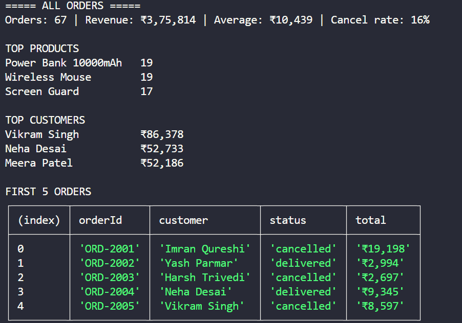

<div align="center">

# 🛒 Flatkart Sales Report

**Turn 67 raw orders into a clear sales report, using only JavaScript array methods.**


<!-- Save your console screenshot as screenshots/report-output.png -->


</div>

---

## 📖 About

Flatkart is a made-up online store. Its manager used to answer the same questions in a spreadsheet every morning: *How much did we earn? What sells best? Who are our top customers?*

This program answers them in one call. Pass it **any list of orders** (all, only delivered, one customer's) and it prints a report.

## ✨ Features

- 📊 **Summary:** orders, revenue, average order, cancel rate
- 🏆 **Top 3** products and customers, with text bar charts
- 🔍 **Filter** by status and **search** by customer name
- ↕️ **Sort** by ID, customer, status, or total
- 🛡️ **Safe with bad data:** empty lists and `null` customers never crash it

## 🚀 Quick Start

```bash
git clone https://github.com/Aastha-0777/JS/tree/main/sales-analytics-dashboard
cd sales-analytics-dashboard
node script.js
```

> No Node? Copy `script.js`, press `F12` in any browser, open **Console**, paste, and press Enter.

## 🧪 Usage

```js
printReport(orders, "ALL ORDERS");                          // full report
printReport(filterByStatus(orders, "delivered"), "DELIVERED");  // one status
printReport(searchByCustomer(orders, "patel"), "PATEL");    // one customer

console.log(getSummary(orders));
// { orders: 67, revenue: 375814, average: 10439, cancelRate: 16 }
```

<details>
<summary><b>👀 Click to see sample output</b></summary>

```
===== DELIVERED ORDERS =====
Orders: 36 | Revenue: ₹3,75,814 | Average: ₹10,439 | Cancel rate: 0%

TOP PRODUCTS
Boat Earbuds         13
USB-C Cable          13
Water Bottle         13

TOP CUSTOMERS
Vikram Singh         ₹55,988
Neha Desai           ₹49,437
Meera Patel          ₹45,789
```

</details>

<details>
<summary><b>🧩 Click to see all functions</b></summary>

| Function | What it does |
|---|---|
| `getOrderTotal(order)` | Total of one order (price × qty) |
| `getRevenue(list)` | Revenue from delivered orders |
| `getAverageOrderValue(list)` | Revenue ÷ delivered orders |
| `getCancelRate(list)` | Cancelled orders as a % |
| `getSummary(list)` | All four numbers in one object |
| `getTopProducts(list, n)` | Top `n` products by quantity |
| `getTopCustomers(list, n)` | Top `n` customers by spend |
| `filterByStatus(list, status)` | Keep one status (`"all"` keeps everything) |
| `searchByCustomer(list, text)` | Case-insensitive name search |
| `applyFilters(list, status, text)` | Filter and search together |
| `sortOrders(list, key, direction)` | New sorted array, original untouched |
| `printReport(list, title)` | Prints the full report |

</details>

<details>
<summary><b>📐 Click to see the business rules</b></summary>

1. **Revenue** counts only `delivered` orders (so it is ₹0 for Shipped or Pending lists).
2. **Average order** = revenue ÷ delivered orders. **Cancel rate** = cancelled ÷ all orders. Empty lists give `0`.
3. **Top lists** ignore cancelled orders. Ties are sorted A-Z.
4. A `null` customer is shown as **"Unknown customer"**.
5. Sorting **never changes** the original `orders` array.

</details>

## 🗺️ Roadmap

- [x] Summary numbers, rankings, filter, search, sort, report
- [ ] Revenue by category
- [ ] Best sales day and repeat customers
- [ ] Web page version (after learning the DOM)

## 🧠 What I Practiced

`map` · `filter` · `flatMap` · `reduce` · `sort` · `slice` · `Object.entries` · edge cases · debugging with `console.table`

---

<div align="center">

Made by **Aastha Lakhatariya** · [@Aastha-0777](https://github.com/Aastha-0777) · MIT License

</div>