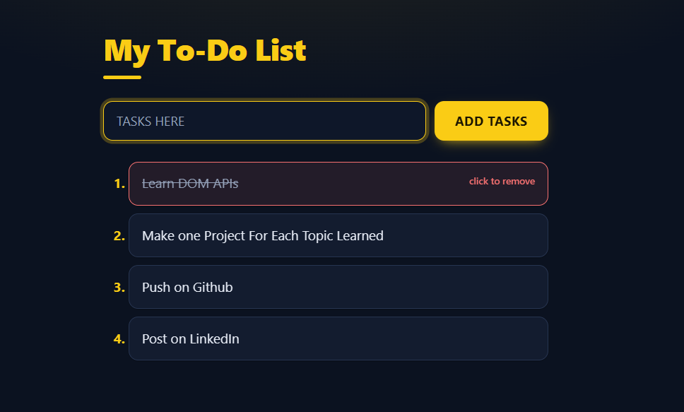
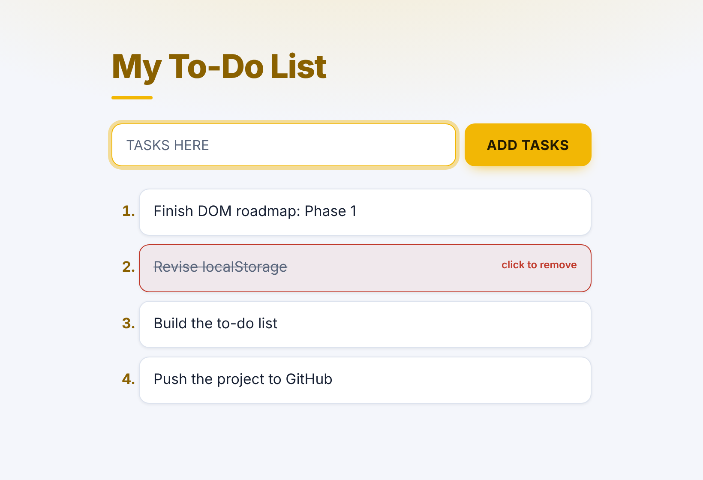
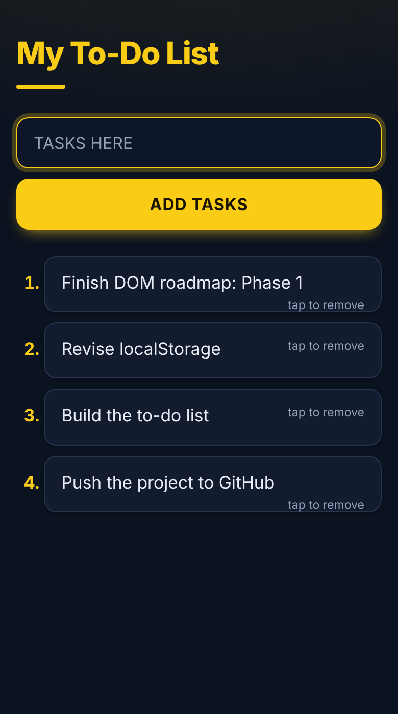

<div align="center">

# ✅ JS To-Do List

**A clean, responsive to-do list built entirely with vanilla JavaScript DOM APIs.**




🔗 **Live demo:** [https://github.com/Aastha-0777/JS/tree/main/to-do-list](https://github.com/Aastha-0777/JS/tree/main/to-do-list)

</div>

---

## 📖 About

A small app with a clear job: type a task, add it, and click it when it's done.

The whole page (heading, form, list, and messages) is **created from `script.js`** with `document.createElement`, on purpose, to practise the DOM API. The styling lives in a separate `style.css` with light and dark themes.

> In larger projects, static markup usually lives in the HTML file. Building it in JavaScript here was a learning choice.

## ✨ Features

- ➕ **Add tasks** with the button or the **Enter** key
- 🚫 **Validation:** empty or space-only input is ignored, with a friendly message
- 🗑️ **Click or tap a task to remove it.** Numbers update automatically
- 🛡️ **Safe text:** whatever you type is shown as plain text, so `<b>hi</b>` appears as typed, not as bold
- 🫥 **Empty state:** a helpful message when there are no tasks
- 🌗 **Light and dark themes** that follow your device setting
- 📱 **Responsive:** works on phones, with "tap to remove" hints on touch screens
- ♿ **Considerate defaults:** visible focus rings, and animations switch off for people who prefer reduced motion
- 📦 **Zero dependencies:** no frameworks, no build step

## 🚀 Getting Started

```bash
git clone https://github.com/Aastha-0777/JS/tree/main/to-do-list.git
cd to-do-list
```

Then open **`index.html`** in your browser. That's it. There is nothing to install or build.

> Tip: in VS Code, the *Live Server* extension reloads the page every time you save.

## 🧪 How to Use

1. Type a task in the input.
2. Press **ADD TASKS** (or hit **Enter**).
3. Click or tap a task to remove it.

<details>
<summary><b>📸 See more screenshots</b></summary>

<br>

<p align="center">
  
  &nbsp;&nbsp;
  
</p>

</details>

<details>
<summary><b>🧠 Code highlight: one listener for every task</b></summary>

<br>

Instead of adding a click listener to every `li`, there is **one** listener on the list. Clicks on a task "bubble up" to the `ol`, and `closest("li")` finds which task was clicked:

```js
ol.addEventListener("click", (event) => {
  const li = event.target.closest("li");
  if (!li) return;     // the click was on empty space in the list
  li.remove();
});
```

This pattern is called **event delegation**. It works for tasks added later, and it uses less memory than one listener per task.

</details>

<details>
<summary><b>🧩 DOM APIs used in this project</b></summary>

<br>

| API | Used for |
|---|---|
| `document.createElement()` | Building the form, heading, list, and every task |
| `appendChild()` / `remove()` | Adding and deleting elements |
| `textContent` | Putting user text on the page safely |
| `className` | Connecting elements to the CSS |
| `addEventListener()` | Reacting to clicks |
| `event.preventDefault()` | Stopping the form from reloading the page |
| `event.target.closest()` | Event delegation |
| `input.value` / `.trim()` / `.focus()` | Reading, checking, and refocusing the input |

</details>

<details>
<summary><b>✅ Manual test checklist</b></summary>

<br>

| Action | Expected result |
|---|---|
| Type `Buy milk`, press Add | `Buy milk` appears and the input clears |
| Press Enter in the input | Adds the task too |
| Press Add with an empty input | "Please Enter a Task" appears |
| Press Add with only spaces | The same message, and nothing is added |
| Click a task | Only that task is removed |
| Click the empty space in the list | Nothing happens |
| Type `<b>hi</b>` | Shown literally as text |
| Add a very long word | It wraps and doesn't break the layout |

</details>

## 📁 Project Structure

```
<to-do-list>/
├── index.html        # Empty page shell: loads style.css and script.js
├── script.js         # Builds the page and handles all the behaviour
├── style.css         # Themes, layout, and responsive styles
├── README.md
└── screenshots/      # Images used in this README
```

## 🗺️ Roadmap

- [x] Add and remove tasks
- [x] Input validation and error message
- [x] Event delegation for removing tasks
- [x] Light and dark themes, responsive layout
- [ ] Save tasks with `localStorage`, so they survive a refresh
- [ ] Mark a task as done (strikethrough) instead of removing it right away
- [ ] A real delete button on each task, so it works with the keyboard
- [ ] Filter: All / Active / Done
- [ ] Fade-out animation when a task is removed

## 🧠 What I Learned

- Building a full interface with `createElement` instead of writing HTML
- How events bubble, and how event delegation keeps code short
- Why `textContent` is safer than `innerHTML` for user input
- Controlling visual order with CSS `order` and `display: contents`
- Theming with CSS variables and `prefers-color-scheme`
- Testing behaviour by hand, including edge cases like empty input and very long words

---

<div align="center">

Made by **Aastha Lakhatariya** · [@Aastha-0777](https://github.com/Aastha-0777) · MIT License

</div>